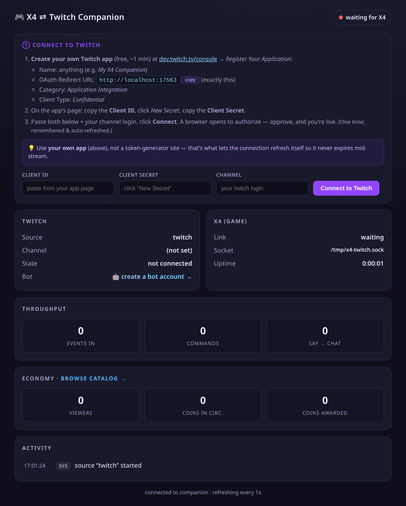
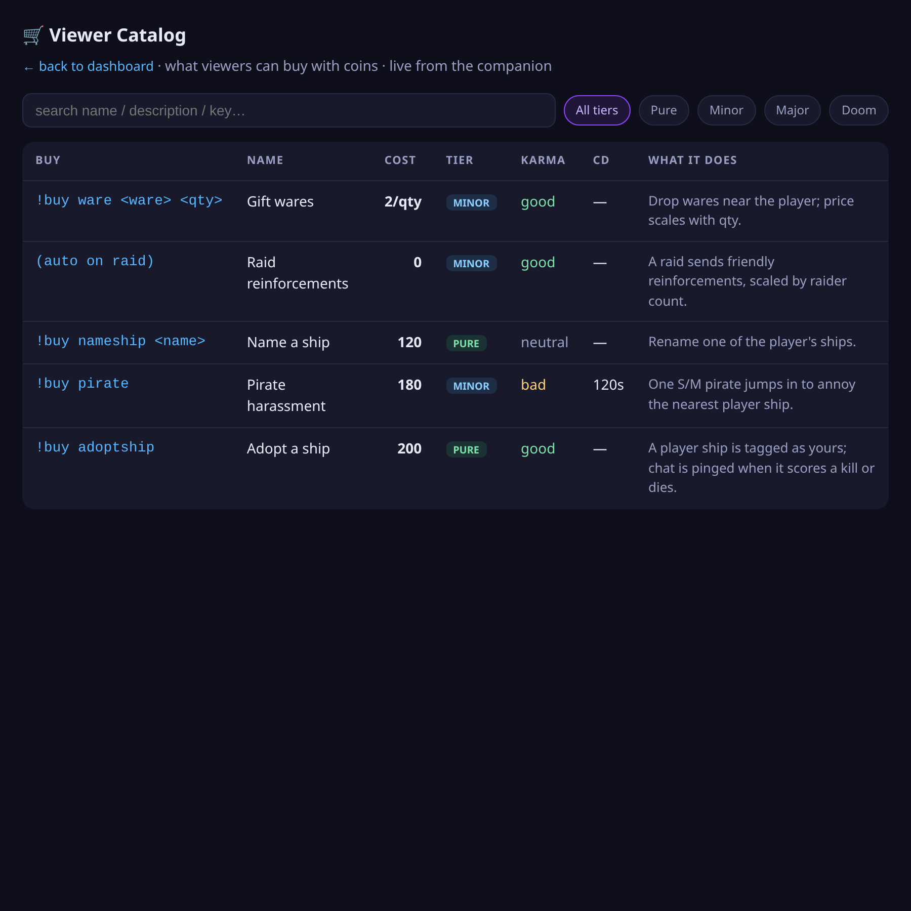
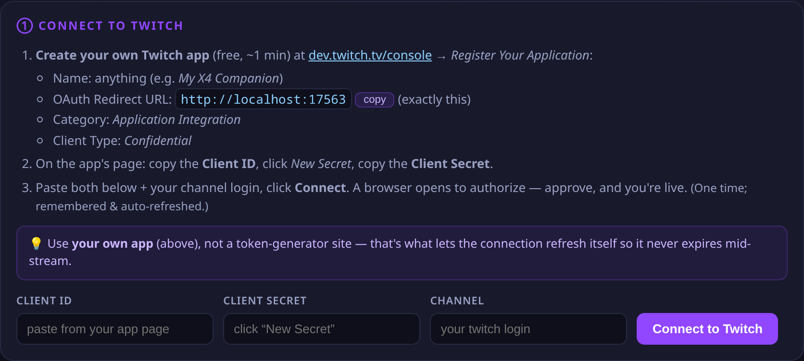

<p align="center"></p>

# X4 Twitch Integration Mod

A from-scratch **Twitch integration mod for X4: Foundations** — a two-way bridge so Twitch
chat, channel points, subs, bits and raids drive in-game events, and in-game events post
back to chat. Inspired by RimWorld's *TwitchToolkit*, adapted to X4.

## Status
**Milestone 1 proven live on X4 8.00 (native Linux):** the hardest, least-documented part —
a bidirectional socket between native-Linux X4 and an external process — works end to end
(see [`docs/07`](docs/07-live-bringup-checklist.md) Track C). The viewer-facing layer is built
and tested headless:

- **`bridge/`** — the Python companion: Twitch↔X4 bridge + a coin **wallet**, **karma**
  governor, `!buy` **store**, a localhost **dashboard** (status + searchable catalog), and a
  one-click **Twitch OAuth** setup panel. ~10 test modules + a Playwright UI check, all green.
- **`extensions/twitch_integration/`** — the X4 mod (MD + Lua), loading and round-tripping the
  socket in-game.

**Remaining (needs the live game / your Twitch app):** the real OAuth flow, MD cues + actual
X4 effects per catalog event, and the in-game Enable-Twitch panel. Day-by-day log:
[`docs/DEVLOG.md`](docs/DEVLOG.md).

## What it looks like
The companion is a small localhost web app — a live status dashboard and a searchable catalog
of what viewers can buy. (Screenshots regenerate via `python bridge/tools/make_screenshots.py`.)

| Dashboard | Catalog (the "item-list") |
|---|---|
| [](docs/img/dashboard.png) | [](docs/img/catalog.png) |

## How it works (the short version)
X4 mods can't open sockets or reach the network. So Twitch lives in a small **companion app**
that bridges into the game:

```
Twitch  ⇄  Companion (Python): OAuth + EventSub + Helix + economy + dashboard
                                    │  localhost Unix socket
                                    ▼
                 LuaSocket inside X4  ⇄  MD scripts (game logic)
```

On **Linux** (this project's target) the socket is a **Unix domain socket opened inside X4**
via a side-loaded **LuaSocket** library — the MIT-licensed, X4-8.x-maintained **bekopharm
`linux-compat` fork** of the Mod Support APIs. Our MD scripts use its documented **Named Pipes
API**; the companion connects in as a client. (In-game process spawning is blocked by X4's FFI
sandbox, so the companion is started separately — see [`docs/09`](docs/09-onboarding-oauth-and-companion-ux.md).)

## Quick start

### Linux (native X4 via the LuaSocket fork)
```bash
pip install -r bridge/requirements.txt   # one-time Python deps (twitchAPI)
./install.sh                             # mod → X4 + companion bundled inside the mod + app launcher
```

### Windows (native X4 via the stock SirNukes Named Pipes API)
On Windows the transport is a **native named pipe** (`\\.\pipe\twitch`): the same
mod + MD, but the companion HOSTS the pipe and X4 connects in as a client (the
mirror image of the Linux Unix-socket setup — no LuaSocket fork needed, just the
stock **SirNukes Mod Support APIs**, which you already have if pipes-based mods work).
```powershell
py -m pip install -r bridge\requirements.txt              # one-time Python deps (twitchAPI)
powershell -ExecutionPolicy Bypass -File .\install.ps1    # auto-detects X4, or pass -X4Dir '...'
```
Then start it from the Start Menu — **"X4 Twitch Companion"** — or double-click
**`Start Companion.cmd`** in `<X4>\extensions\twitch_integration\companion\`. (That
`.cmd` is what makes it double-clickable: Windows opens a bare `.ps1` in Notepad and
the execution policy blocks it, so the wrapper calls `run-companion.ps1` with
`-ExecutionPolicy Bypass`. Pass args through it too, e.g. `--source stdin` to test
without Twitch.)

In X4: **Settings → Extensions** → enable *Twitch Integration* (and *SirNukes Mod
Support APIs*), turn **Protected UI Mode OFF** (needed to load the winpipe DLL),
then load a save. The companion's dashboard shows **X4: connected** once the game
attaches to the pipe.

### Launching the companion — no file-hunting
The installer adds a menu entry (**Start Menu** on Windows, **app menu** on Linux) named
*X4 Twitch Companion*; the companion also re-installs that entry itself on every start, so a
mod someone *shared* with you gets one after its first run. It lives *inside* the installed
mod (`<X4>/extensions/twitch_integration/companion/`), so it travels with the mod and is
found wherever X4's mods are — double-click `Start Companion.cmd` (Windows) /
`run-companion.sh` (Linux) there if you'd rather not use the menu. The dashboard opens at
`http://127.0.0.1:17564/`. (For development, run it straight from the repo instead:
`bridge\Start Companion.cmd` / `./bridge/run-companion.sh`; re-run the installer to redeploy
after code changes.)
### Registries — re-run after installing a DLC or a game update
Everything the mod needs to know about game content is **generated from your X4 install**, so
names, prices, macros and ids are the game's real ones rather than a hand-kept list that
quietly rots. Pass your install path to each (`<X4>` below):

```powershell
py bridge\tools\gen_ships.py       "<X4>"   # ships.json  — !buy ship <name>, priced per hull
py bridge\tools\gen_sectors.py     "<X4>"   # sectors.json — !buy <station> <sector>
py bridge\tools\gen_characters.py  "<X4>"   # lets the Twitch factions have NPCs
py bridge\tools\gen_ware_owners.py "<X4>"   # lets their docks stock equipment
py bridge\tools\check_macros.py    "<X4>"   # audit: no MD macro outside base game + DLC
```

The first two feed the companion (`bridge/twitch_bridge/*.json`); the next two write `<diff>`
files into `extensions/twitch_integration/libraries/`. A DLC adds ships, sectors, characters
and wares — re-run them all, then redeploy. `check_macros.py` is a check, not a generator: it
fails if the mod references a macro that only exists because *you* have some other mod
installed, which is a bug that only shows up on someone else's machine.

## Setting up Twitch (one-time)
The companion uses **your own free Twitch app**, so the connection refreshes itself and never
expires mid-stream. (A token-generator site such as *twitchtokengenerator* hands you a token
that can't self-refresh — fine for an old IRC chat bot, but not for the modern **EventSub** API
this project uses. See [`docs/09`](docs/09-onboarding-oauth-and-companion-ux.md).)

The companion's **① Connect to Twitch** panel walks you through it:



1. **Create your own Twitch app** (free, ~1 min) at
   **[dev.twitch.tv/console](https://dev.twitch.tv/console/apps/create)** → *Register Your Application*:
   - **Name:** anything (e.g. *My X4 Companion*)
   - **OAuth Redirect URL:** `http://localhost:17563` (exactly this)
   - **Category:** *Application Integration*
   - **Client Type:** *Confidential*
2. On the app's page, copy the **Client ID**, click **New Secret**, copy the **Client Secret**.
3. Paste both + your channel login into the panel and click **Connect**. Your browser opens to
   authorize — approve, and you're live (one time; remembered & auto-refreshed).

> Want messages to come from a separate bot name? Create a second Twitch account first
> ([twitch.tv/signup](https://www.twitch.tv/signup)), sign into it in your browser, then
> authorize as that account in step 3.

Credentials are stored locally (gitignored, `chmod 600`) — never in the repo. See
[`SECURITY.md`](SECURITY.md).

## Reference bank — read in order
| Doc | What's in it |
|-----|--------------|
| [`docs/00`](docs/00-overview-and-architecture.md) | Goal, the sandbox constraint, full architecture, wire protocol. |
| [`docs/01`](docs/01-x4-modding-basics.md) | Extension layout, content.xml, MD cues, Lua UI loading. |
| [`docs/02`](docs/02-network-bridge-linux.md) | Named Pipes vs LuaSocket; the Linux socket mechanism. |
| [`docs/03`](docs/03-twitch-api.md) | EventSub, OAuth scopes, sending chat. |
| [`docs/04`](docs/04-build-plan.md) | Staged milestones + resolved decisions. |
| [`docs/05`](docs/05-native-cpp-and-ffi-option.md) | The C++/native (LuaJIT FFI) route — and why we don't use it. |
| [`docs/06`](docs/06-ecosystem-survey.md) | **Verified survey of the modding ecosystem + the resolved architecture.** |
| [`docs/07`](docs/07-live-bringup-checklist.md) | Install + first-run steps; the live bring-up log + bug ledger. |
| [`docs/08`](docs/08-viewer-economy-and-events.md) | **Viewer economy & events** — wallet, karma, the store, 4 severity tiers, the item-list. |
| [`docs/09`](docs/09-onboarding-oauth-and-companion-ux.md) | **Onboarding/OAuth/companion UX** — why Twitch can't live fully in-game. |
| [`docs/10`](docs/10-adopted-ships.md) | **Adopted ships** — the fleet roster, adoption/abandon/resurrect, and the game→bridge state flow. |
| [`docs/DEVLOG.md`](docs/DEVLOG.md) | Chronological engineering log. |
| [`docs/references.md`](docs/references.md) | Every source URL. |

## Next step
Live OAuth test from the companion, then wire the first real X4 effect (a catalog event →
an actual in-game spawn) in a loaded game.
